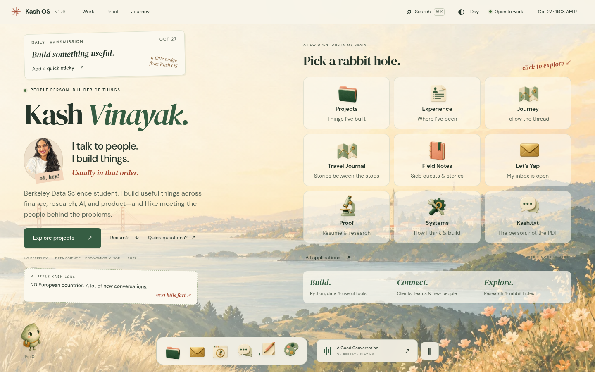

# Kash OS — ready for owner review

The replacement is on **kash-os** only. Main and the existing GitHub Pages source are unchanged. This is not a production deployment.



[See a case study](review/case-study.png) · [Night mode](review/desktop-night.png) · [Dark mode](review/desktop-dark.png) · [Phone launcher](review/mobile.png) · [Phone app](review/mobile-app.png)

## Try it

Download the **kash-os branch** ZIP from GitHub, extract it, and open Terminal in that extracted folder. Run:

```sh
npm ci
npm run dev
```

Open `http://localhost:3000` in your browser. Node 20+ required. Do not double-click index.html; the app uses JavaScript modules and needs a local HTTP server.

Start with Projects, then open Kash.txt, Field Notes, or the Whiteboard. Ctrl/Cmd+K searches. Minimize a window and restore it from the dock. Try themes in Personalize. Music is opt-in; Voice Guide contains an optional AI-generated introduction in Kash’s cloned voice, followed by scripted text answers. No microphone, live conversation, or runtime AI service.

[AI introduction and text guide](review/voice-guide.png) · [Phone voice guide](review/voice-guide-mobile.png)

## Review points

- Illustrated likeness, Pip, original app icons, and background art.
- Project descriptions and their limits/attribution.
- All reported metrics remain qualified rather than independently verified.
- Phone-free web résumé preserves qualifications; the private original upload is untouched.
- Client-facing positioning, travel personality, and the balance of professional proof with side quests.

No booking notifications, commercial songs, phone contact links, tracking, transcript, private travel itinerary, or invented project demos are included.

## Validation

Frozen dependency installation, build, content/privacy audit, and syntax checks pass. Browser suite: 19 verification groups including all 20 applications, all-app automated WCAG AA checks, Day/Night/Dark desktop checks, mobile Projects accessibility, nine viewport sizes, window management, search, persistent notes, folders, game, original audio, companion, malformed storage, and public route checks. Clean review screenshots additionally verify that companion bubbles stay clear of phone app content.

See [TEST_REPORT.md](TEST_REPORT.md), [CLAIM_LEDGER.md](CLAIM_LEDGER.md), and [ASSET_MANIFEST.md](ASSET_MANIFEST.md). Automated audits supplement, rather than constitute, a complete human accessibility certification. Speech output varies by browser/device; full text is always available.

After owner approval, merge/release can be a separate step. No public replacement URL is claimed yet.
